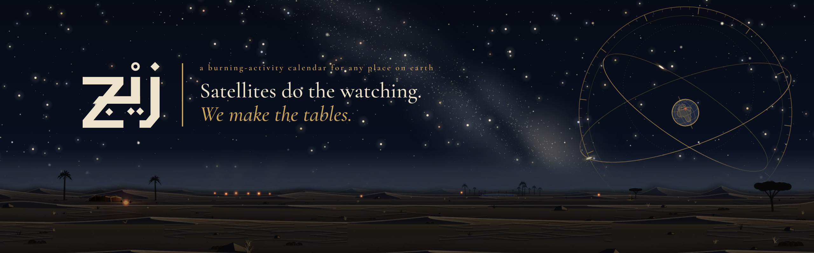

NASA's record of fires is split between two instruments: MODIS, since 2000, and VIIRS, since 2012. Over the Nile Delta, VIIRS sees 11 to 20 times more fire pixels than MODIS, so joining the two records fakes a jump in burning. Zij will turn both into one burning calendar for any place on earth, with its margin of error stated. It is named after the zij, the book of astronomical tables Ibn Yunus kept in Cairo around the year 1000.

## At NASA Space Apps Cairo 2026

13 to 14 November 2026, challenge “Harmonization of MODIS and VIIRS Hot Spots”. During the hackathon:

- We will read the MODIS and VIIRS hot spots from NASA FIRMS and put them on one scale, calibrated over the years both satellites flew together.
- We will draw the burning calendar for any place on earth: years down, weeks across, each week set against that place's normal.
- We will give every figure its margin of error, and mark weeks without satellite data as no data, never as no fire.

The app itself is built at the event, starting on 13 November.

## Film, proposal and data

- [Registration film](https://youtu.be/daS0nt3OqcI) on YouTube
- [Proposal](https://zij.watch/proposal) (PDF)
- Data: [NASA FIRMS](https://firms.modaps.eosdis.nasa.gov/) for the fire hot spots, [NASA GIBS](https://www.earthdata.nasa.gov/engage/open-data-services-software/earthdata-developer-portal/gibs-api) for the base imagery

## Repositories

The app's repository opens at the event.

---

Team Zij · Cairo
